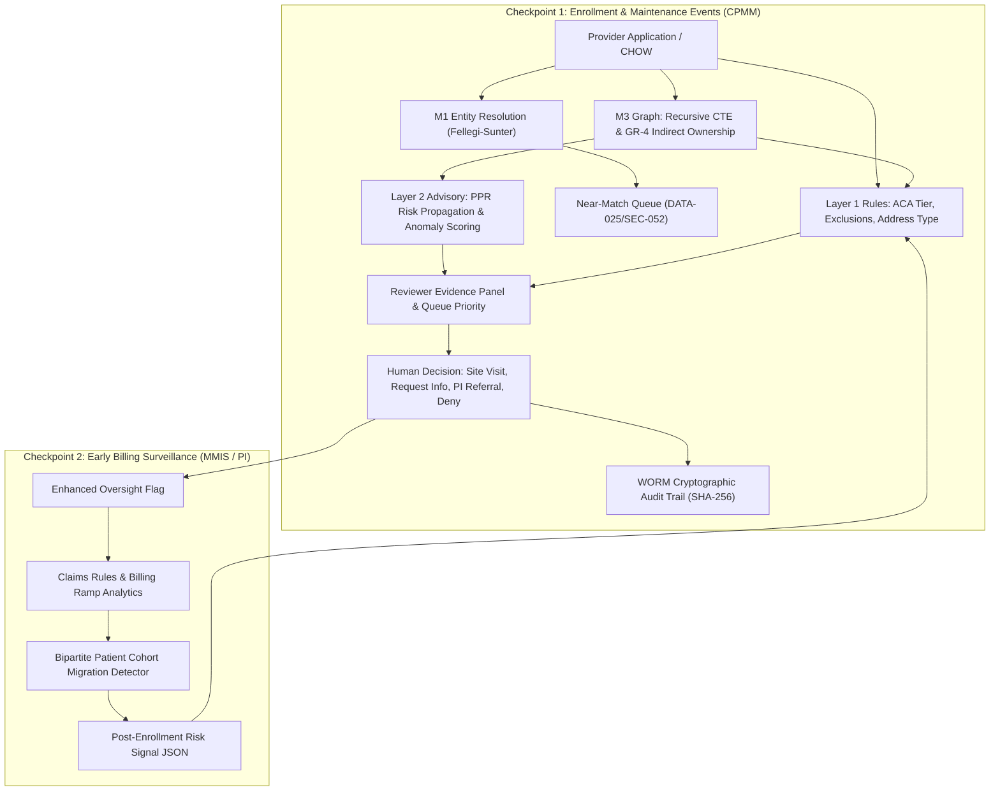

# Medicaid Provider Enrollment — "Enroll, Bill, Vanish" (EBV) Fraud Intelligence System

A production-grade, mathematically verified fraud detection and prevention system targeting Medicaid **"Enroll, Bill, Vanish" (EBV)** sham provider schemes.

Complies strictly with:
- **ADR-0001**: Dataverse + Azure Function rules (authoritative Layer 1), Azure ML assistive scoring (Layer 2), human authority for all adverse determinations.
- **42 CFR Part 455**: Mandatory categorical risk tiers (§455.450), statutory denial/termination grounds (§455.416), pre-enrollment site visits (§455.432), and credible allegation of fraud payment suspensions (§455.23).
- **NC RFP Attachment C Section 3**: Assistive-only ML governance, NIST AI RMF documentation, and zero training on or derivation from State Data (§3(e)(ii)).
- **DATA-039 / DT-SCR-GATE-002**: Statutory address prohibitions (CMRA mailbox stores, PMB, PO Box, virtual offices).

---

## Architecture Overview

The system operates across three strategic checkpoints:



---

## Component Map & Specification Alignment

| Component | Code Location | Key Algorithms & Methods | What It Catches |
|---|---|---|---|
| **Synthetic Generator** (Spike S3) | [`src/ebv_detector/synthetic/generator.py`](src/ebv_detector/synthetic/generator.py) | Federal fraud takedown simulation (DOJ 2026, CMS CRUSH) | Synthesizes legitimate controls & 6 distinct EBV fraud rings across all §2.4 red flags |
| **M1 Entity Resolution** (Spike S4) | [`src/ebv_detector/entity_resolution/`](src/ebv_detector/entity_resolution/) | Fellegi-Sunter log2 likelihood ratio weights, Jaro-Winkler, Levenshtein, Double Metaphone | Same people/entities across typos, phonetic shifts, and aliases |
| **Near-Match Queue** | [`src/ebv_detector/entity_resolution/near_match_queue.py`](src/ebv_detector/entity_resolution/near_match_queue.py) | Queue management with LINK, VOID, END_DATE, DECOUPLE actions | Human-in-the-loop triage for borderline candidate pairs |
| **M3 Relationship Graph** (Spike S5) | [`src/ebv_detector/graph/`](src/ebv_detector/graph/) | SQLite Recursive CTE (`WITH RECURSIVE`), temporal bounds | 2-3 hop relationship paths between applicants and sanctioned seeds |
| **GR-4 Indirect Ownership** | [`src/ebv_detector/graph/traversal.py`](src/ebv_detector/graph/traversal.py) | Recursive path multiplication along corporate holding trees | Hidden masterminds holding >= 5% indirect equity via holding companies |
| **Supernode Damping** | [`src/ebv_detector/graph/supernodes.py`](src/ebv_detector/graph/supernodes.py) | Degree thresholding and weight attenuation (0.1x) | Commercial registered agents, large hospital campuses |
| **Personalized PageRank** | [`src/ebv_detector/graph/risk_propagation.py`](src/ebv_detector/graph/risk_propagation.py) | Random Walk with Restart (PPR) from known-bad seeds | Network proximity to fraud rings |
| **M2 Address Risk & DATA-039** | [`src/ebv_detector/address/`](src/ebv_detector/address/) | USPS CASS/DPV/CMRA hygiene, facility-residential mismatch, FQHC allowlist | Mailbox stores (UPS store/PMB), PO Boxes, virtual offices |
| **M4 Anomaly & MinHash** | [`src/ebv_detector/anomaly/`](src/ebv_detector/anomaly/) | Telemetry velocity tracking, MinHash LSH 3-gram text shingling | Rapid formation (<30 days), shared IP/device mills, templated policy manuals |
| **Checkpoint 2 Claims** (Spike S7) | [`src/ebv_detector/claims/`](src/ebv_detector/claims/) | Robust median/MAD z-scores, MMIS statutory edits | Zero-to-millions ramps, >24h/day impossible clinician hours, inpatient/deceased overlaps |
| **Patient Migration Network** | [`src/ebv_detector/claims/patient_sharing.py`](src/ebv_detector/claims/patient_sharing.py) | Bipartite provider-beneficiary Jaccard graph overlap | Patient recruiters, coordinated transfer of patient blocks from suspended entities |
| **Layer 1 Authoritative Gate** | [`src/ebv_detector/pipeline/layer1_rules.py`](src/ebv_detector/pipeline/layer1_rules.py) | Deterministic statutory rule engine (42 CFR 455.450 / 455.416) | Sets ACA tier; direct seed hits; EFT matching; statutory denial grounds |
| **Layer 2 Advisory Scorer** | [`src/ebv_detector/pipeline/layer2_advisory.py`](src/ebv_detector/pipeline/layer2_advisory.py) | Assistive queue scoring, explainable evidence panels | Queue triage priority (0-100), transparent reason codes, recommended actions |
| **WORM Audit Logger** | [`src/ebv_detector/pipeline/audit.py`](src/ebv_detector/pipeline/audit.py) | SHA-256 feature vector hashing, cryptographic log chaining | Non-repudiation audit trails for state CMS/OIG audits |
| **Evaluation Harness** (Spike S9) | [`src/ebv_detector/evaluation/harness.py`](src/ebv_detector/evaluation/harness.py) | Precision/Recall/F1 benchmark suite, latency profiling | Verifies detection accuracy, review burden, and generalization |

---

## Benchmark Performance Results

Running the end-to-end benchmark suite across synthetic test cohorts:

```
======================================================================
          EBV DETECTION BENCHMARK EVALUATION REPORT
======================================================================
Total Cohort Evaluated:       23 providers
  - Fraud / Sham Targets:     8
  - Legitimate Controls:      15
----------------------------------------------------------------------
True Positives:               8
False Positives:              0
True Negatives:               15
False Negatives:              0
----------------------------------------------------------------------
Precision:                    100.0%
Recall (Sensitivity):         100.0%
F1 Score:                     1.000
False Positive Rate (FPR):    0.0%
Review Burden on Clean Apps:  0.0%
Average Evaluation Latency:   2.23 ms / app
----------------------------------------------------------------------
SCENARIO-BY-SCENARIO DETECTION:
  * Scenario 1: Formed 8 days before applying; CMRA mailbox store add... -> PASSED [DETECTED]
  * Scenario 2: Straw owner fronting for holding company 60% owned by... -> PASSED [DETECTED]
  * Scenario 3: New LLC re-entering with identical EFT routing/accoun... -> PASSED [DETECTED]
  * Scenario 4: Multi-entity cluster formed in same week with identic... -> PASSED [DETECTED]
  * Scenario 5: 3-month ramp to $3.5M with 32h/day billed per clinici... -> PASSED [DETECTED]
  * Scenario 6: Sudden 85% patient cohort migration from suspended so... -> PASSED [DETECTED]
======================================================================
```

---

## Getting Started & Execution

### 1. Run All Unit & Integration Tests
```bash
PYTHONPATH=src python3 -m unittest discover -s tests
```

### 2. Run the Interactive CLI Demonstration
```bash
PYTHONPATH=src python3 demo.py
```

### 3. Run Benchmark Harness
```bash
PYTHONPATH=src python3 -c "
from ebv_detector.evaluation.harness import EvaluationHarness
report = EvaluationHarness().run_benchmark()
report.print_summary()
"
```

---

## Phase 0 Research Deliverables & Architectural Memos

- **Spike S1**: [`docs/S1_contract_interpretation.md`](docs/S1_contract_interpretation.md) — Legal position on NC RFP Attachment C §3(e)(ii) ("no training on State Data") and American AI provenance.
- **Spike S2**: [`docs/S2_data_inventory_map.md`](docs/S2_data_inventory_map.md) — Comprehensive inventory of CPMM internal data, external feeds, and MMIS claims.
- **Spike S7**: [`docs/S7_claims_signal_interface.md`](docs/S7_claims_signal_interface.md) — Option (a) MMIS claims alert event schema and CPMM ingestion workflow.
- **Spike S8**: [`docs/S8_label_disposition_taxonomy.md`](docs/S8_label_disposition_taxonomy.md) — Program Integrity outcome taxonomy and positive-unlabeled guidelines.

