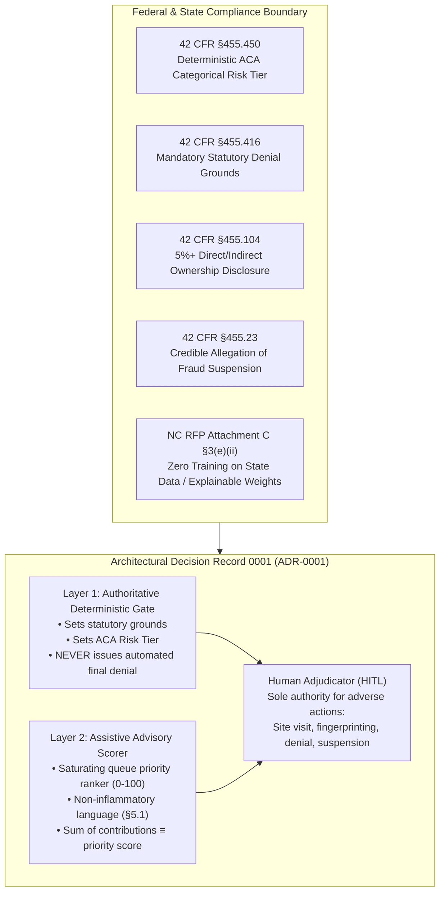
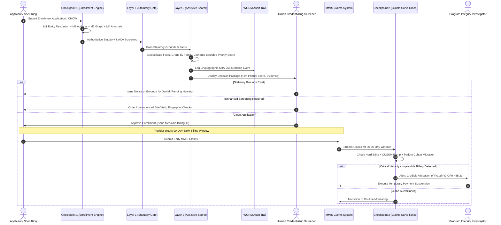
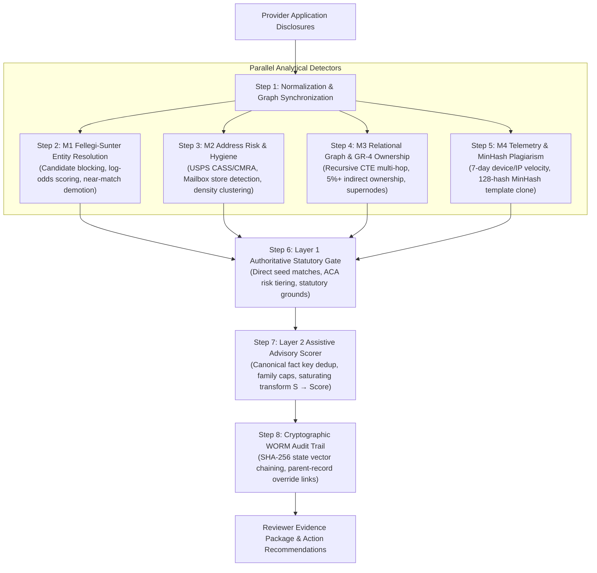
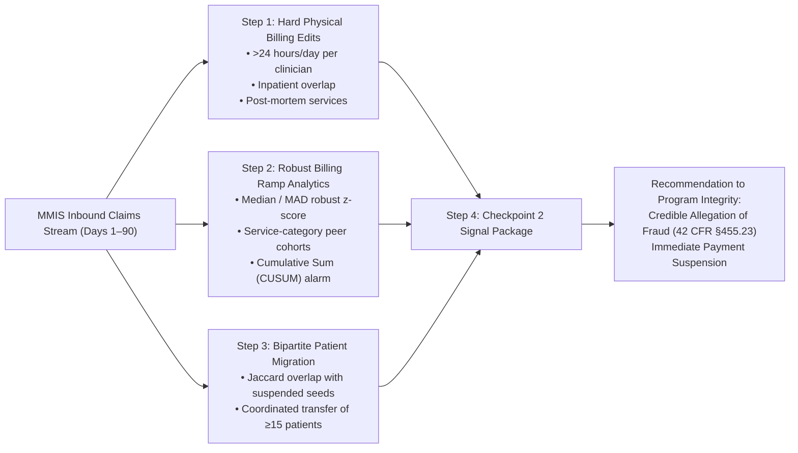

# Medicaid "Enroll, Bill, Vanish" (EBV) Fraud Intelligence System
## Complete End-to-End System Flow & Architecture Guide
**Document ID:** `DOC-EBV-END-TO-END-001`  
**Classification:** State Medicaid Program Integrity / Compliance & Engineering Reference  
**Target Threat:** "Enroll, Bill, Vanish" (EBV) Sham Healthcare Provider Syndicates  
**Compliance Standards:** 42 CFR Part 455, NC RFP Attachment C §3, ADR-0001 Architecture  
**Release Version:** `2.0.0-PROD` (Includes Phase A & Phase B Audit Improvements)

---

## Table of Contents
1. [Executive Summary & The "Enroll, Bill, Vanish" Problem](#1-executive-summary--the-enroll-bill-vanish-problem)
2. [Guiding Architectural Principles & Regulatory Mandates](#2-guiding-architectural-principles--regulatory-mandates)
3. [System Lifecycle: The Two Strategic Checkpoints](#3-system-lifecycle-the-two-strategic-checkpoints)
4. [Checkpoint 1: Pre-Enrollment & Maintenance Screening (Step-by-Step)](#4-checkpoint-1-pre-enrollment--maintenance-screening-step-by-step)
   - [Step 1: Application Ingestion & Normalization](#step-1-application-ingestion--normalization)
   - [Step 2: M1 Entity Resolution & Near-Match Queue (Fellegi-Sunter)](#step-2-m1-entity-resolution--near-match-queue-fellegi-sunter)
   - [Step 3: M2 Physical Location & Prohibited Address Hygiene](#step-3-m2-physical-location--prohibited-address-hygiene)
   - [Step 4: M3 Relational Graph & GR-4 Indirect Ownership Traversal](#step-4-m3-relational-graph--gr-4-indirect-ownership-traversal)
   - [Step 5: M4 Telemetry Velocity & MinHash Template Plagiarism](#step-5-m4-telemetry-velocity--minhash-template-plagiarism)
   - [Step 6: Layer 1 Authoritative Statutory Gate](#step-6-layer-1-authoritative-statutory-gate)
   - [Step 7: Layer 2 Assistive Advisory Scorer (Saturating Transform)](#step-7-layer-2-assistive-advisory-scorer-saturating-transform)
   - [Step 8: Cryptographic WORM Audit Trail & Reviewer Override](#step-8-cryptographic-worm-audit-trail--reviewer-override)
5. [Checkpoint 2: Early Billing Surveillance (Days 1 to 90)](#5-checkpoint-2-early-billing-surveillance-days-1-to-90)
   - [Step 1: Deterministic Hard Physical Billing Edits](#step-1-deterministic-hard-physical-billing-edits)
   - [Step 2: Billing Velocity & Robust MAD Z-Score Ramp Detection](#step-2-billing-velocity--robust-mad-z-score-ramp-detection)
   - [Step 3: Bipartite Patient Cohort Migration Detector](#step-3-bipartite-patient-cohort-migration-detector)
   - [Step 4: Post-Enrollment Risk Signal & 42 CFR 455.23 Action](#step-4-post-enrollment-risk-signal--42-cfr-45523-action)
6. [The 6 Core Fraud Typology Scenarios Explained](#6-the-6-core-fraud-typology-scenarios-explained)
7. [Comprehensive Q&A & Interview Cheat Sheet](#7-comprehensive-qa--interview-cheat-sheet)

---

## 1. Executive Summary & The "Enroll, Bill, Vanish" Problem

### What is "Enroll, Bill, Vanish" (EBV) Fraud?
Medicaid provider fraud historically operated on a "pay-and-chase" model: claims were paid first, and post-payment audits 12 to 24 months later attempted to recover improper disbursements. Organized criminal rings exploit this lag using the **EBV scheme**:
1. **Enroll:** Form a shell company with Secretary of State, recruit nominee/straw owners or stolen identities, obtain a National Provider Identifier (NPI), and submit a Medicaid enrollment application using fabricated policy manuals and commercial mail receiving agency (CMRA) addresses.
2. **Bill:** Rapidly ramp claims from zero to millions of dollars in the first 30 to 90 days across high-risk service categories (HCBS, Behavioral Health, Autism/ABA, Personal Care Services), billing for phantom patients, post-mortem beneficiaries, or impossible clinician hours (>24h/day).
3. **Vanish:** Before annual revalidation or post-payment audits occur, sweep the funds out through automated clearing house (ACH/EFT) bank accounts, dissolve the shell, and steer recruited patients to a newly enrolled entity.

### How Does This System Defeat EBV Fraud?
This system replaces retrospective pay-and-chase with **pre-enrollment deterrence and rapid post-enrollment claims surveillance**:
* **At Checkpoint 1 (Enrollment):** It stops the shell provider before a Medicaid billing number is issued by cross-referencing exclusion seeds, uncovering hidden upstream corporate masters, detecting template clones, and catching fake physical addresses.
* **At Checkpoint 2 (Early Billing):** If a provider does enroll, the system tracks claims daily across the first 90 days, flagging billing ramps, impossible clinician workloads, and patient block migrations within days rather than years.

---

## 2. Guiding Architectural Principles & Regulatory Mandates

Every line of code is bound by strict federal statutes and state contract constraints:



1. **ADR-0001 Dual-Layer Separation**:
   - **Layer 1 (Statutory Authority)**: Sole engine permitted to evaluate statutory grounds (42 CFR 455.416) and assign ACA Categorical Risk Tiers (42 CFR 455.450). Layer 1 flags applications as `GROUNDS_PENDING_HUMAN_DECISION`, leaving final denial authority strictly with human hearing officers.
   - **Layer 2 (Assistive Advisory)**: Produces an assistive queue priority score ($0-100$) to rank reviewer workloads. It **never auto-denies**, never overrides ACA tiers, and complies with NIST AI RMF explainability standards.
2. **NC RFP Attachment C §3(e)(ii) Non-Derivation Constraint**:
   - Zero machine learning models are trained or fine-tuned on North Carolina State Data. All Fellegi-Sunter likelihood ratios, spatial thresholds, and family caps are **expert-calibrated, rule-bounded, and fully versioned**.
3. **Section 5.1 Language Standard**:
   - The system uses objective regulatory language: *"Pattern requires priority human review due to critical screening indicators"*, never accusatory labels like *"Fraud"* or *"Scam"*.

---

## 3. System Lifecycle: The Two Strategic Checkpoints



---

## 4. Checkpoint 1: Pre-Enrollment & Maintenance Screening (Step-by-Step)

Checkpoint 1 executes inside [`src/ebv_detector/pipeline/checkpoint1.py`](file:///Users/saivinayrayala/Documents/ML%20Engineer%20Handoff%20Enroll%20Bill%20Vanish/src/ebv_detector/pipeline/checkpoint1.py). When an application arrives, it undergoes an 8-step pipeline:



---

### Step 1: Application Ingestion & Normalization
* **File:** [`src/ebv_detector/pipeline/checkpoint1.py`](file:///Users/saivinayrayala/Documents/ML%20Engineer%20Handoff%20Enroll%20Bill%20Vanish/src/ebv_detector/pipeline/checkpoint1.py) (`_sync_application_to_graph`)
* **What happens:**
  - Standardizes legal names (uppercase, removes legal corporate suffixes: LLC, Inc, Corp, PLLC).
  - Cleans 10-digit telephone numbers (`"".join(filter(str.isdigit, phone))`).
  - Normalizes addresses into standardized single lines (`STREET, CITY, STATE, ZIP5`).
  - Maps nodes and edges into the SQLite graph store (`graph_nodes`, `graph_edges`).
  - **Idempotency Rule (§3.10):** Uses an `ON CONFLICT DO UPDATE` upsert on `(source_id, target_id, edge_type, effective_start)`. Re-scoring an application never creates duplicate edges.

---

### Step 2: M1 Entity Resolution & Near-Match Queue (Fellegi-Sunter)
* **File:** [`src/ebv_detector/entity_resolution/fellegi_sunter.py`](file:///Users/saivinayrayala/Documents/ML%20Engineer%20Handoff%20Enroll%20Bill%20Vanish/src/ebv_detector/entity_resolution/fellegi_sunter.py)
* **Objective:** Catches individuals attempting to re-enroll after prior exclusion using aliases, minor misspellings, or straw nominee entities.
* **Algorithm (Fellegi-Sunter Log-Likelihood Ratio):**
  1. **Multi-Pass Blocking:** Candidates are blocked across 6 fast keys (NPI, TIN, SSN4+DOB, Phone, EFT routing/account, and Zip5+FirstWord) to reduce $O(N^2)$ comparisons to a small subset.
  2. **Field-Level Comparisons:** Uses Jaro-Winkler, Levenshtein, Double Metaphone, and Token-Set similarity.
  3. **Log-Likelihood Score:** For each field, calculates log-odds:
     $$W = \sum_{i} \text{weight}_i, \quad w_{\text{agree}} = \log_2\left(\frac{m_i}{u_i}\right), \quad w_{\text{disagree}} = \log_2\left(\frac{1 - m_i}{1 - u_i}\right)$$
     *NPI agreement adds $+16.6$ bits; TIN agreement adds $+14.2$ bits; NPI disagreement subtracts $-6.6$ bits; TIN disagreement subtracts $-5.1$ bits.*
  4. **Hard Conflict Demotion Rule (§3.7):**
     If an application shares a business name or phone with an existing provider but has **different NPI or TIN**, the system flags a hard conflict and **demotes the match from `AUTO_LINK` to `SEND_TO_QUEUE`** ([`NearMatchQueue`](file:///Users/saivinayrayala/Documents/ML%20Engineer%20Handoff%20Enroll%20Bill%20Vanish/src/ebv_detector/entity_resolution/near_match_queue.py)). Auto-link requires $\ge 2$ agreeing strong identifiers (NPI, TIN, EFT, SSN4+DOB) and zero hard conflicts.

---

### Step 3: M2 Physical Location & Prohibited Address Hygiene
* **Files:** [`src/ebv_detector/address/rules.py`](file:///Users/saivinayrayala/Documents/ML%20Engineer%20Handoff%20Enroll%20Bill%20Vanish/src/ebv_detector/address/rules.py), [`src/ebv_detector/address/clustering.py`](file:///Users/saivinayrayala/Documents/ML%20Engineer%20Handoff%20Enroll%20Bill%20Vanish/src/ebv_detector/address/clustering.py)
* **Objective:** Enforces federal prohibition of shell addresses under **DATA-039 / DT-SCR-GATE-002**.
* **Checks Executed:**
  - **Statutory Prohibitions:** Evaluates USPS Commercial Mail Receiving Agency (CMRA) flag, Private Mailbox (PMB) numbers, PO Boxes, and virtual office suites. If present, flags `L1-ADDR-CMRA-PROHIBITED` as a statutory denial ground.
  - **Facility vs. Residential Mismatch:** Flags clinic facility categories (Ambulatory Surgery, Psychiatric Rehab, Autism Clinic) disclosing residential Delivery Point Validation (RDI) addresses.
  - **Allowlist Exemption:** Legitimate high-density campuses (Federally Qualified Health Centers - FQHC, Community Health Centers - CHC, Hospital Campuses, and Tribal Health) are allowlisted and exempt from cluster flags.
  - **Density Clustering:** Unrelated commercial entities co-located in the same building/suite are tracked logarithmically: $\log_2(N / 3)$.

---

### Step 4: M3 Relational Graph & GR-4 Indirect Ownership Traversal
* **Files:** [`src/ebv_detector/graph/traversal.py`](file:///Users/saivinayrayala/Documents/ML%20Engineer%20Handoff%20Enroll%20Bill%20Vanish/src/ebv_detector/graph/traversal.py), [`src/ebv_detector/graph/supernodes.py`](file:///Users/saivinayrayala/Documents/ML%20Engineer%20Handoff%20Enroll%20Bill%20Vanish/src/ebv_detector/graph/supernodes.py), [`src/ebv_detector/graph/risk_propagation.py`](file:///Users/saivinayrayala/Documents/ML%20Engineer%20Handoff%20Enroll%20Bill%20Vanish/src/ebv_detector/graph/risk_propagation.py)
* **Objective:** Uncovers barred masterminds hiding behind tiered holding companies or straw nominees under **42 CFR §455.104**.
* **Key Mechanisms:**
  1. **ANSI SQL Recursive CTE Multi-Hop Traversal:**
     ```sql
     WITH RECURSIVE path_cte AS (
         SELECT source_id, target_id, edge_type, 1 AS hops, ...
         UNION ALL
         SELECT e.source_id, e.target_id, e.edge_type, p.hops + 1, ...
     )
     ```
     Traverses $2-3$ relationship hops between applicant NPIs, bank accounts, phones, and known-bad seeds.
  2. **GR-4 Indirect Equity Calculation:**
     Multiplies equity percentages down parent holding chains. For example, if Excluded Person A owns 60% of Holding Corp B, and Holding Corp B owns 80% of Applicant C:
     $$\text{Indirect Equity} = 60\% \times 80\% = 48.0\% \ge 5.0\% \text{ (Statutory Threshold)}$$
     Automatically triggers statutory denial grounds under 42 CFR 455.104 / 455.416.
  3. **Supernode Damping:**
     High-degree hubs (commercial registered agents with $>30$ corporate links) have edge weights attenuated by $0.1\times$ so that standard incorporation services do not falsely connect thousands of clean entities to a rogue applicant.
  4. **PageRank Suppression Rule (§3.2, §3.6):**
     Personalized PageRank (PPR) is computed from adverse seeds. However, **if an explicit graph path or direct seed hit explains the affiliation, PageRank points are suppressed to zero** to prevent double-counting.

---

### Step 5: M4 Telemetry Velocity & MinHash Template Plagiarism
* **Files:** [`src/ebv_detector/anomaly/application.py`](file:///Users/saivinayrayala/Documents/ML%20Engineer%20Handoff%20Enroll%20Bill%20Vanish/src/ebv_detector/anomaly/application.py), [`src/ebv_detector/anomaly/template.py`](file:///Users/saivinayrayala/Documents/ML%20Engineer%20Handoff%20Enroll%20Bill%20Vanish/src/ebv_detector/anomaly/template.py)
* **Objective:** Detects high-volume enrollment mills submitting identical applications under different names.
* **Detectors:**
  - **Entity Age:** Days between Secretary of State entity formation and application submission. Formation $<30$ days prior triggers rapid formation review; unparseable dates trigger data quality review.
  - **Sliding Window Hardware & IP Velocity:** Detects $>3$ submissions from the same device fingerprint or IP address within a **7-day sliding window**, or $>3$ from the same email within **30 days**.
  - **128-Permutation MinHash Document NLP:** EBV syndicates purchase or clone boilerplate clinical policy manuals. The engine tokenizes text into character 3-grams and computes Jaccard similarity across 128 universal hash functions:
    $$J(A, B) \approx \frac{1}{128} \sum_{k=1}^{128} \mathbb{I}\left(h_k(A) = h_k(B)\right)$$
    Similarity $\ge 0.80$ collapses into a single evidence item scored logarithmically: $1.5 + \log_2(1 + \text{matching\_apps})$.

---

### Step 6: Layer 1 Authoritative Statutory Gate
* **File:** [`src/ebv_detector/pipeline/layer1_rules.py`](file:///Users/saivinayrayala/Documents/ML%20Engineer%20Handoff%20Enroll%20Bill%20Vanish/src/ebv_detector/pipeline/layer1_rules.py)
* **Objective:** Authoritative statutory compliance evaluation under **ADR-0001**.
* **Decisions Evaluated:**
  1. **Categorical ACA Risk Tier (42 CFR §455.450):**
     - **HIGH:** Home Health, HCBS, DME, Hospice, NEMT, Personal Care Services, or any provider with prior terminations. Requires mandatory unannounced site visit (§455.432) and FBI fingerprint criminal background checks (§455.434).
     - **MODERATE:** Behavioral Health, CMHC, Autism ABA Clinic, Adult Day Care, Ambulance. Requires unannounced site visit (§455.432).
     - **LIMITED:** Physicians, Family Practice, Dentists, Hospitals.
  2. **Direct Exclusion Grounds (42 CFR §455.416):**
     - Cross-references active sanction seeds by NPI, TIN, SSN4+DOB, EFT, Phone, and Address.
     - Confirms seed is active as of application date (`seed.is_active_on(app.application_date)`).
  3. **Output Status:**
     - `GROUNDS_PENDING_HUMAN_DECISION`: If statutory grounds exist (referred to hearing officer).
     - `REVIEW_REQUIRED`: If ACA Moderate/High tier or anomaly patterns exist.
     - `AUTO_APPROVE_ELIGIBLE`: If Limited tier with zero anomalies.

---

### Step 7: Layer 2 Assistive Advisory Scorer (Saturating Transform)
* **File:** [`src/ebv_detector/pipeline/layer2_advisory.py`](file:///Users/saivinayrayala/Documents/ML%20Engineer%20Handoff%20Enroll%20Bill%20Vanish/src/ebv_detector/pipeline/layer2_advisory.py)
* **Objective:** Orders reviewer queues by assistive priority ($0-100$) with explainable, non-overlapping feature contributions.

#### The Mathematical Scoring Pipeline:
1. **Fact Key De-Duplication:** Every evidence item carries a canonical `fact_key` (e.g. `EFT:053000196_9876543210`). Multiple detectors firing on the same underlying fact collapse to the single strongest item.
2. **Family Grouping & Diminishing Returns:** Evidence is grouped into 6 non-overlapping families:
   | Family | Cap | Weight Scale & Rules |
   |---|:---:|---|
   | **AFFILIATION** | 6.0 | Active adverse seed EFT/SSN/NPI/TIN: 5.0; Phone seed: 3.0; Graph path: 3.0 (hop 1-2) or 1.5 (hop 3). PageRank added only when no path explains it. |
   | **OWNERSHIP** | 5.0 | GR-4 indirect excluded owner $\ge 5\%$: 5.0; Disclosed parent without ownership edge: 2.0. |
   | **ADDRESS** | 4.0 | Sanctioned address seed: 4.0; Mailbox/CMRA/PMB: 3.0; Residential mismatch: 2.0; High-density cluster: 2.0. |
   | **SUBMISSION** | 4.0 | Policy clone: $1.5 + \log_2(1 + \text{matches})$; Device/IP/Email velocity: $1.5 + \log_2(1 + \text{count})$. |
   | **IDENTITY** | 4.0 | M1 adverse link: $4.0 \times \text{posterior}$; Near-match queue item: 1.5. |
   | **AGE** | 1.5 | Formed $<30$ days prior: 1.5; Formed $<90$ days prior: 0.75; Missing formation date: 0.5. |

   Within each family, weights decay geometrically: $\text{Weight}_1 \times 1.0 + \text{Weight}_2 \times 0.5 + \text{Weight}_3 \times 0.25$, bounded by `family_caps`.
3. **Saturating Transform ($S \to \text{Priority Score}$):**
   $$S = \sum_{\text{families}} \text{capped\_family\_score}$$
   $$\text{Priority Score} = 100 \times \left(1 - \exp\left(-\frac{S}{4.0}\right)\right)$$
   *Ensures the priority score is smoothly and strictly bounded between 0 and 100.*
4. **Strict Feature Attribution Equality:**
   $$\text{Contribution}_{\text{family}} = \text{Priority Score} \times \left(\frac{\text{capped\_family\_score}}{S}\right)$$
   $$\sum_{\text{families}} \text{Contribution}_{\text{family}} \equiv \text{Priority Score}$$
   The feature contributions displayed on the UI sum **exactly** to the displayed score.
5. **Tailored Review Actions:**
   - Address issues $\to$ Order Unannounced Site Visit (§455.432).
   - EFT issues $\to$ Require Proof of Bank Account Ownership under Business TIN.
   - Ownership/Person issues $\to$ Order FBI Fingerprint Background Checks (§455.434).
   - Direct Seed Link $\to$ Refer to Program Integrity for Credible Allegation Review (§455.23).

---

### Step 8: Cryptographic WORM Audit Trail & Reviewer Override
* **File:** [`src/ebv_detector/pipeline/audit.py`](file:///Users/saivinayrayala/Documents/ML%20Engineer%20Handoff%20Enroll%20Bill%20Vanish/src/ebv_detector/pipeline/audit.py)
* **Objective:** Guarantees non-repudiation and evidentiary integrity for federal CMS/OIG court challenges.
* **Mechanism:**
  - **Feature Vector Hash:** SHA-256 hash of all application fields, disclosures, IP, device, and evidence items.
  - **Chained Audit Hash:**
    $$\text{Audit Hash}_n = \text{SHA256}(\text{Record ID} \parallel \text{Timestamp} \parallel \text{Feature Hash} \parallel \text{Status} \parallel \text{Score} \parallel \text{Config Hash} \parallel \text{Audit Hash}_{n-1})$$
  - **Reviewer Overrides:** When an investigator overrides an evaluation, the system **never edits the old record**. It appends a new `REVIEWER_DECISION` event referencing `parent_record_id`, updating the cryptographic chain.
  - **Audit Verification:** `verify_chain() -> bool` iterates through all records verifying each block matches the previous block's SHA-256 hash.

---

## 5. Checkpoint 2: Early Billing Surveillance (Days 1 to 90)

Checkpoint 2 runs in [`src/ebv_detector/pipeline/checkpoint2.py`](file:///Users/saivinayrayala/Documents/ML%20Engineer%20Handoff%20Enroll%20Bill%20Vanish/src/ebv_detector/pipeline/checkpoint2.py). It streams claims submitted in the first 90 days of enrollment to catch the "Bill" phase before the shell can "Vanish":



---

### Step 1: Deterministic Hard Physical Billing Edits
* **File:** [`src/ebv_detector/claims/billing_rules.py`](file:///Users/saivinayrayala/Documents/ML%20Engineer%20Handoff%20Enroll%20Bill%20Vanish/src/ebv_detector/claims/billing_rules.py)
* **What it catches:**
  1. **Impossible Clinician Hours:** Sums billed service duration per rendering clinician NPI on each calendar date. If duration exceeds **24.0 hours in a single 24-hour day**, flags `CP2-HARD-IMPOSSIBLE-HOURS`.
  2. **Inpatient Hospital Overlap:** Flags outpatient/home-health services billed on dates when hospital MMIS admission files confirm the beneficiary was an admitted inpatient (`CP2-HARD-INPATIENT-OVERLAP`).
  3. **Post-Mortem Services:** Cross-references beneficiary date-of-death (SSA Death Master File). Claims billed after death trigger `CP2-HARD-DECEASED-OVERLAP`.

---

### Step 2: Billing Velocity & Robust MAD Z-Score Ramp Detection
* **File:** [`src/ebv_detector/claims/ramp_detector.py`](file:///Users/saivinayrayala/Documents/ML%20Engineer%20Handoff%20Enroll%20Bill%20Vanish/src/ebv_detector/claims/ramp_detector.py)
* **Objective:** Catches zero-to-millions billing ramps within 3 months of enrollment.
* **Algorithm (Robust Non-Parametric Outlier Model):**
  Instead of mean and standard deviation (which are distorted by extreme fraud spikes), uses **Median and Median Absolute Deviation (MAD)** against peer cohorts of the same taxonomy:
  $$\text{MAD} = \text{median}\left(|X_i - \text{median}(X)|\right)$$
  $$\text{Robust } Z = \frac{X - \text{median}(X)}{1.4826 \times \text{MAD}}$$
  - A robust $Z \ge 3.5$ flags `CP2-RAMP-VELOCITY-ANOMALY`.
  - A robust $Z \ge 5.0$ raises a CUSUM velocity alarm indicating exponential claims escalation.

---

### Step 3: Bipartite Patient Cohort Migration Detector
* **File:** [`src/ebv_detector/claims/patient_sharing.py`](file:///Users/saivinayrayala/Documents/ML%20Engineer%20Handoff%20Enroll%20Bill%20Vanish/src/ebv_detector/claims/patient_sharing.py)
* **Objective:** Catches patient recruiters steering recruited patient blocks from shut-down clinics to newly opened shell entities.
* **Algorithm (Bipartite Jaccard Projection):**
  When an existing provider is suspended by law enforcement, the system indexes their patient roster $P_{\text{suspended}}$. When a newly enrolled provider begins billing, it computes the intersection:
  $$N_{\text{shared}} = |P_{\text{new}} \cap P_{\text{suspended}}|$$
  $$\text{Jaccard Overlap} = \frac{|P_{\text{new}} \cap P_{\text{suspended}}|}{|P_{\text{new}} \cup P_{\text{suspended}}|}$$
  If $N_{\text{shared}} \ge 15$ patients or Jaccard overlap $\ge 0.50$ (and the source provider was suspended before claims appeared at the new provider), flags `CP2-PATIENT-MIGRATION-CLUSTER`.

---

### Step 4: Post-Enrollment Risk Signal & 42 CFR 455.23 Action
* **Output:** [`Checkpoint2SignalPackage`](file:///Users/saivinayrayala/Documents/ML%20Engineer%20Handoff%20Enroll%20Bill%20Vanish/src/ebv_detector/pipeline/checkpoint2.py)
* **Action:**
  - Evaluates whether signals constitute a **Credible Allegation of Fraud (CAF)** under **42 CFR §455.23**.
  - Sets `trigger_payment_suspension = True` and `trigger_unannounced_site_visit = True`.
  - Sends a signal package to the Program Integrity unit recommending an immediate pre-payment suspension to freeze disbursements before funds are swept.

---

## 6. The 6 Core Fraud Typology Scenarios Explained

| Scenario | Typology Name | How It Operates | Detectors That Catch It | Layer 1 Outcome | Layer 2 Score |
|:---:|---|---|---|:---:|:---:|
| **1** | **Commercial Mailbox Shell** | New LLC formed 8 days prior; uses a UPS Store / Commercial Mail Receiving Agency (PMB #402) as its primary service facility for Behavioral Health. | USPS CMRA hygiene, Rapid formation tracker ($<30$ days), Address prohibitions. | `GROUNDS_PENDING_HUMAN_DECISION` (DATA-039 Prohibited Address) | $\approx \mathbf{74.7}$ / CRITICAL (Address + Age) |
| **2** | **Straw Nominee Holding Shell** | Clean straw owner fronting for a parent holding company that is 60% owned by an excluded OIG seed. | ANSI SQL Recursive CTE traversal, GR-4 Indirect Ownership equity multiplication ($60\% \times 80\% = 48\% \ge 5\%$). | `GROUNDS_PENDING_HUMAN_DECISION` (42 CFR 455.104 / 455.416) | $\approx \mathbf{71.3}$ / CRITICAL (Ownership + Affiliation) |
| **3** | **Shared EFT Re-Entry (BEACON)** | Suspended provider re-incorporates under a new legal name and clean NPI, but links the same bank account (routing/account) to receive payments. | EFT seed index, Relational graph edge, 7-day formation. | `GROUNDS_PENDING_HUMAN_DECISION` (42 CFR 455.416(a) shared bank account) | $\approx \mathbf{84.7}$ / CRITICAL (Affiliation + Age) |
| **4** | **Templated Clinician Ring** | Three clinics formed in the same week share an identical cloned policy manual, identical rendering clinician NPIs, and the same device ID. | 128-permutation MinHash LSH ($J \ge 0.85$), Device hardware fingerprint velocity, Shared clinician edges. | `REVIEW_REQUIRED` (ACA Moderate/High screening required) | $\approx \mathbf{76.0}$ / CRITICAL (Submission + Identity + Affiliation) |
| **5** | **Rapid Ramp & Impossible Hours** | Newly enrolled clinic ramps from \$0 to \$3.5M within 3 months, billing 32 hours/day per clinician with inpatient overlaps. | Checkpoint 2 Robust MAD Z-score ($Z > 5.0$), Clinician daily hours audit ($>24\text{h}$), Inpatient overlap cross-reference. | Post-Enrollment CAF Alert (42 CFR §455.23) | Claims Surveillance: Payment Suspension Recommended |
| **6** | **Bipartite Patient Migration** | Following law enforcement suspension of Provider A, 85% of its recruited patient cohort suddenly appears at newly enrolled Provider B. | Bipartite patient-provider graph overlap ($N \ge 15$ shared patients, Jaccard $\ge 0.50$). | Post-Enrollment CAF Alert (42 CFR §455.23) | Claims Surveillance: Immediate Site Visit & Suspension |

---

## 7. Comprehensive Q&A & Interview Cheat Sheet

### Question 1: What is the difference between Layer 1 and Layer 2?
> **Answer:** **Layer 1 is authoritative and deterministic; Layer 2 is assistive and advisory.**  
> Under federal regulations (42 CFR Part 455) and ADR-0001, machine learning models are legally prohibited from denying an applicant or setting ACA risk tiers. Layer 1 applies strict statutory rules: it assigns the ACA Risk Tier (§455.450) and flags statutory denial grounds (§455.416). Layer 2 uses statistical and machine learning models to synthesize all evidence into an explainable Priority Score ($0-100$) so human screeners can triage backlogs efficiently.

### Question 2: Why did you redesign the Layer 2 priority score to use a saturating exponential?
> **Answer:** To eliminate **point stacking and unbounded score inflation**.  
> Previously, linear additive scoring added points for Layer 1 grounds ($+50$), ACA tiers ($+25$), and every evidence item. A single compromised bank account could fire across 4 detectors and produce a score of $128+$. We redesigned it with:
> 1. Canonical `fact_key` de-duplication (a fact is scored once).
> 2. 6 non-overlapping families with diminishing returns and family caps.
> 3. A saturating transform $\text{Priority} = 100 \times (1 - \exp(-S / 4.0))$.
> This guarantees scores are bounded in $[0, 100]$ and feature contributions sum **identically** to the displayed score.

### Question 3: How does the system comply with NC RFP Attachment C §3(e)(ii)?
> **Answer:** By enforcing **zero training, fitting, or fine-tuning on North Carolina State Data**.  
> Fitting unsupervised clustering (DBSCAN), Isolation Forests, or supervised classifiers on state data would violate state procurement terms without a written contract ruling. Instead, all Fellegi-Sunter likelihood ratios, spatial radii, MinHash thresholds, and family caps are **expert-calibrated, rule-bounded, and versioned in configuration**.

### Question 4: How does Fellegi-Sunter handle identity resolution when an NPI or TIN conflicts?
> **Answer:** Through **hard identifier conflict demotion**.  
> In probabilistic linkage, sharing a business name and phone yields high positive log-odds. However, if two applications have different NPIs or TINs, that is a hard identifier conflict. Our implementation deducts negative log-odds ($-6.6$ bits for NPI, $-5.1$ bits for TIN) and **automatically demotes the pair from `AUTO_LINK` to `SEND_TO_QUEUE`** ([`NearMatchQueue`](file:///Users/saivinayrayala/Documents/ML%20Engineer%20Handoff%20Enroll%20Bill%20Vanish/src/ebv_detector/entity_resolution/near_match_queue.py)) with an explanatory audit notice so human reviewers can adjudicate potential re-incorporations.

### Question 5: How does the WORM audit trail prevent tampering if a human reviewer overrides a recommendation?
> **Answer:** Through an **append-only chained ledger pattern**.  
> Reviewer overrides **never mutate existing records**. When a reviewer overrides an outcome, the system generates a new `REVIEWER_DECISION` record that points to `parent_record_id` and incorporates the previous record's SHA-256 hash into its own hash. Calling `verify_chain()` mathematically verifies the cryptographic chain from the genesis record to the latest override.

### Question 6: How does the system handle supernodes in the relationship graph?
> **Answer:** Through **supernode degree attenuation**.  
> In corporate registries, commercial registered agents incorporate thousands of clean businesses at the same address. Without attenuation, a single rogue entity at that agent would connect thousands of clean doctors to a fraud seed. Our system identifies supernodes ($>30$ links) and attenuates graph transition weights by $0.1\times$, preventing false-positive guilt-by-association.

### Question 7: How does Checkpoint 2 differ from traditional claims fraud detection?
> **Answer:** It focuses on the **early billing window (first 30 to 90 days)** to catch "Bill and Vanish" schemes before funds leave the state.  
> It does not wait for annual claims profiles. Instead, it evaluates daily streaming claims for physical impossibilities ($>24$ hours/day per clinician, hospital inpatient overlap, services after death), robust non-parametric ramps against peer cohorts ($Z > 5.0$), and mass patient cohort migration from shut-down clinics, recommending immediate payment suspension under **42 CFR §455.23**.
