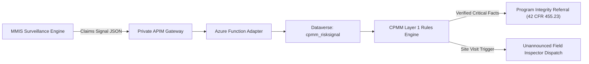

# Phase 0 Research Spike S7 — Claims-Signal Interface Specification

| Document Metadata | Specification |
|---|---|
| **Author** | Senior ML Engineer |
| **Date** | 2026-11-11 |
| **Interface Target** | MMIS (Claims Engine) ↔ CPMM / CMdS Provider (Enrollment Management) |
| **Applicable Standards** | 42 CFR 455.23 (Payment Suspension), ADR-0001, FHIR / REST JSON |
| **Status** | **Architectural Recommendation (Option A)** |

---

## 1. Architectural Scope & Strategic Choice

In §4.2 of the Handoff Document, two operational models were analyzed:
- **Option (a) Alert-In Architecture**: MMIS / PI / SURS claims analytics compute billing ramp anomalies and impossible hours edits natively or via a specialized stream, emitting structured alert events into CPMM. CPMM acts on these alerts as enrollment maintenance triggers (initiating unannounced site visits, off-cycle revalidations, or PI referrals).
- **Option (b) In-Engine Hosting**: Hosting raw MMIS claims pipelines inside CPMM's Azure ML. This requires massive claims ETL into CPMM, separate data-sharing agreements, and increased HIPAA surface area.

### Architect Recommendation: **Option (a) Alert-In Interface**
Option (a) achieves rapid deployment, preserves strict boundaries under NC RFP Attachment C, and decouples claims adjudication from provider credentialing.

---

## 2. Event Payload Schema

Signals from Checkpoint 2 are emitted as JSON events over Azure Service Bus or Private APIM webhooks.

### 2.1 Event Schema: `MedicaidProviderRiskSignal`

```json
{
  "$schema": "https://json-schema.cpmm.state.gov/v1/provider-risk-signal.json",
  "eventId": "EVT-SIG-20260315-009182",
  "timestampUtc": "2026-03-15T14:32:00Z",
  "sourceSystem": "MMIS_PI_SURVEILLANCE_ENGINE",
  "provider": {
    "npi": "1900000021",
    "tin": "56-0000021",
    "legalBusinessName": "TRIANGLE CRISIS & REHAB PARTNERS LLC",
    "serviceCategory": "BEHAVIORAL_HEALTH",
    "monthsEnrolled": 3
  },
  "signalSummary": {
    "signalType": "BILLING_RAMP_AND_IMPOSSIBLE_HOURS",
    "severity": "CRITICAL",
    "compositeRiskScore": 92.5,
    "recommendedAction": "CREDIBLE_ALLEGATION_OF_FRAUD_REFERRAL"
  },
  "metrics": {
    "totalPaidLast30Days": 3245000.00,
    "cohortMedianPaid30Days": 85000.00,
    "robustZScore": 8.42,
    "impossibleHoursViolations": 14,
    "maxHoursInSingleDay": 36.0,
    "inpatientOverlapClaims": 12,
    "postMortemClaims": 2,
    "patientMigrationJaccard": 0.00
  },
  "evidenceItems": [
    {
      "code": "CP2-RAMP-ABNORMAL-VELOCITY",
      "severity": "CRITICAL",
      "verifiedFact": true,
      "description": "Provider billed $3,245,000.00 in month 3, exhibiting a robust z-score of +8.4x above peer cohort median ($85,000.00)."
    },
    {
      "code": "CP2-BILLING-IMPOSSIBLE-HOURS",
      "severity": "CRITICAL",
      "verifiedFact": true,
      "description": "14 clinician-days exceeded 24 hours of care billed in a single 24-hour day (max 36.0 hours on 2026-03-15)."
    },
    {
      "code": "CP2-BILLING-INPATIENT-OVERLAP",
      "severity": "CRITICAL",
      "verifiedFact": true,
      "description": "12 claims billed for community care while beneficiary was admitted to inpatient hospital facility."
    }
  ]
}
```

---

## 3. CPMM Maintenance Event Ingestion Workflow



### Action Protocols in CPMM:
1. **Critical Signal (Impossible Hours, Post-Mortem, Patient Migration from Suspended Provider)**:
   - Dataverse enrollment status moves to `UNDER_INVESTIGATION`.
   - Notification dispatched to Program Integrity for CAF payment suspension evaluation under 42 CFR 455.23.
   - Prepayment claims review flag sent to MMIS to withhold disbursements pending audit.
2. **High Signal (Ramp Velocity Anomaly alone, robust z > 3.5)**:
   - Automated dispatch of unannounced site inspection to verify clinic operating capacity.
   - Off-cycle revalidation notice issued under 42 CFR 455.414.

