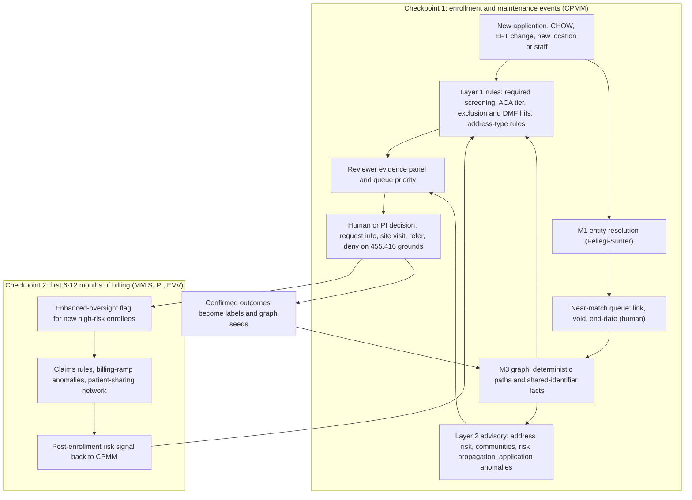

# ML Engineer Handoff — Detecting "Enroll, Bill, Vanish" Sham Providers

| | |
|---|---|
| Date | 2026-10-24 |
| From | Program leadership, via Cursor chat (state Medicaid director perspective) |
| To | ML engineer picking up fraud-detection research and build |
| Product | CPMM / CMdS Provider / NextGen PEM |
| Status | **Research handoff.** Everything marked *proposal* comes from the chat and has not been accepted. Nothing here overrides [ADR-0001](../architecture/ADR-0001-cmds-provider-finalized-software.md) or a pending architect disposition (§11) |
| Read with | [m1-m7-ml-algorithms-explained.md](m1-m7-ml-algorithms-explained.md), [provider-screening-intelligence-design-v1.md](../architecture/BRs/provider-screening-intelligence-design-v1.md), [PEM-ML-Fraud-Detection-Consolidated.md](../architecture/ML/PEM-ML-Fraud-Detection-Consolidated.md) |

---

## 0. Two-minute summary

- **Target scheme.** The chat ranked **"enroll, bill, vanish" (EBV)** as the top current Medicaid provider-enrollment fraud pattern. Newly formed or straw-owned companies enroll in low-barrier services (home- and community-based services, behavioral health and substance use, autism therapy, non-emergency transportation, adult day, increasingly hospice). They bill heavily within months, disappear, then come back under new names. Minnesota, Arizona, Maryland, Utah and California all froze enrollment or raised screening for specific provider types in 2025–2026 (§2.3).
- **Core insight.** The scheme's defining feature is **the same people behind many companies that look unrelated on paper**. Claims data alone does not show that; entity resolution plus a relationship graph does. For EBV, **M1 (entity resolution)** and **M3 (relationship graph)** are the highest-value components.
- **Prevention only happens at decision points.** A score matters only if it changes what happens before payment: which applications a human escalates (site visit, extra verification, Program Integrity referral), which new providers get closer billing monitoring, and which claims are held.
- **Most front-door defense can be deterministic.** Verified facts ("shares an EFT account with a terminated provider", "owner is two hops from an excluded person", "address is a mailbox store") can be Layer 1 rule inputs. Learned scores stay advisory. This fits CPMM governance and the NC contract.
- **Biggest gap vs the current design.** M1–M7 cover enrollment only. EBV's billing stage (zero-to-millions ramps, impossible hours, patients moving together between providers) needs claims and EVV data from the State's MMIS or program-integrity system. That is new scope and needs a decision (§4.2, §11).
- **Hard constraints.** ML never approves, denies, suspends or sets the ACA risk tier (ADR-0001). NC RFP Attachment C §3(e)(ii) bars using State Data to train or improve ML models; §5(d) and §7 add State review and change control for model versions (§5.2). Round-2 model reviews lean "rules-first" and are not yet dispositioned (§4.3).
- **Where to start.** Phase 0 spikes that need no training on State Data: contract interpretation, data inventory, synthetic EBV data, a Fellegi-Sunter prototype on public data (feeds GR-6), a deterministic graph prototype, an evaluation harness, and a claims-signal interface memo (§9.1).

---

## 1. What the chat covered

| Turn | Question | Outcome |
|---|---|---|
| 1 | Top two current fraud, waste and abuse patterns in Medicaid provider enrollment | **EBV** sham providers (mainly fraud), and **SCG** — screening compliance gaps, where ineligible or unverified providers get in or stay in (mainly waste and abuse) |
| 2 | Which ML algorithms address EBV, and how they prevent it | Layered design across three checkpoints: enrollment, first months of billing, re-entry (§3) |
| 3 | Hand off to the ML engineer | This document, reconciled against the existing M1–M7 design (§4) |

**Naming note.** The chat called EBV "Pattern 1". In the consolidated catalog, **Pattern 1 is Identity Theft / Stolen NPI**. This document uses **EBV** for the chat's scheme and **P1–P20** only for catalog patterns.

---

## 2. The problem: EBV

### 2.1 Lifecycle

1. **Enter.** Form an LLC shortly before applying. Enroll in a provider type that is easy to get into and often screened at "limited" risk. Hide true owners behind nominees or holding companies. Use a mailbox-store, virtual-office or residential address for a facility-based service. List clinicians whose credentials are borrowed or shared across many companies. Variant: buy an already-enrolled company and do not report the change of ownership.
2. **Bill.** Ramp from zero to millions within months. Bill impossible volumes, ghost patients, and services during hospital stays or after death. Recruit beneficiaries with kickbacks (cash, housing, hotel stays), often targeting vulnerable people.
3. **Vanish.** Close or go dormant as audits, suspensions or site visits approach. Move money out, sometimes after a last-minute bank-account change.
4. **Re-enter.** The same people return under new entity names, NPIs and tax IDs, through nominee owners, or in neighboring states. Patients often move with them.

### 2.2 Where it concentrates

Home- and community-based services (personal care, adult day, individualized and integrated community supports, housing stabilization); behavioral health and substance use (sober living, intensive outpatient, psychiatric rehabilitation, crisis stabilization, peer support); autism therapy (ABA, Minnesota's EIDBI); non-emergency medical transportation; hospice.

### 2.3 Evidence gathered in the chat

| Item | Fact | Source |
|---|---|---|
| Minnesota scale | Federal prosecutors estimate half or more of roughly $18B paid since 2018 across 14 high-risk programs may be fraudulent | [AP](https://apnews.com/article/minnesota-fraud-charges-fbad68312012dc02a4060852474f72ee), [CBS Minnesota](https://www.cbsnews.com/minnesota/news/billions-paid-out-by-medicaid-in-minnesota-may-be-fraudulent-us-attorney/) |
| Minnesota federal action | CMS found substantial noncompliance (Jan 2026; proposed withholding about $515M per quarter). Corrective action plan approved Mar 19, 2026. $259.5M deferred (Feb 2026) | [Federal Register 2026-00547](https://www.govinfo.gov/content/pkg/FR-2026-01-14/pdf/2026-00547.pdf), [Georgetown CCF](https://ccf.georgetown.edu/2026/03/24/cms-weaponizes-fraud-against-medicaid-in-minnesota-an-unexpected-development/), [CMS](https://www.cms.gov/newsroom/press-releases/trump-administration-prioritizes-affordability-announcing-major-crackdown-health-care-fraud) |
| Minnesota enrollment freeze | CMS directed a freeze on new enrollment in 13 high-risk categories plus revalidation of existing providers; exceptions need written CMS approval. Housing Stabilization Services ended Oct 2025; about 800 inactive providers disenrolled | [MN DHS](https://content.govdelivery.com/accounts/MNDHS/bulletins/4037215) |
| Minnesota prepayment lesson | Every fee-for-service claim for the 14 services is suspended for vendor prepayment analytics (the vendor's Phase 1 report lists 192 targeted analytics). Many providers went about a month without payment. DHS later told the Legislative Auditor that many claims first flagged did not warrant concern once the analytics were corrected to reflect program policy | [MN DHS FAQ](https://mn.gov/dhs/partners-and-providers/news-initiatives-reports-workgroups/minnesota-health-care-programs/provider-news/pre-payment-review-faq.jsp), [Optum Phase 1 report](https://www.lrl.mn.gov/docs/2026/other/260346/mn-pi-phase-1-summary-report-13026-final-redacted.pdf), [MN Reformer](https://minnesotareformer.com/2026/02/02/lawmakers-question-walz-administration-over-rollout-of-fraud-audit-program/), [OLA](https://www.auditor.leg.state.mn.us/sreview/pdf/2026-dhs-vulnerability-assessment.pdf) |
| Arizona | Sober-living scheme estimated at $2.8B; 378 providers suspended (as of May 2024); 317 moratorium applications denied; 280 indictments (Jun 2026); about 5% recovered (May 2025). Billing signatures: excessive hours in 24 hours, simultaneous services, ghost billing, services after death | [KJZZ](https://www.kjzz.org/politics/2026-06-24/arizona-ag-announces-42-new-medicaid-fraud-indictments-bringing-total-to-280), [AHCCCS fact sheet](https://azahcccs.gov/Shared/Downloads/News/2023/ProviderPaymentSuspensionFactSheet.pdf), [AHCCCS](https://azahcccs.gov/Fraud/ProgramIntegrity.html), [AZCIR](https://azcir.org/news/2025/05/06/most-arizona-taxpayer-funds-lost-in-2-billion-medicaid-fraud-scheme/) |
| Maryland | Moratorium on new psychiatric rehabilitation, partial hospitalization and intensive outpatient enrollments in 10 jurisdictions, extended six months from Jul 1, 2026. Growth followed a move to accreditation-based licensing | [MDH](https://health.maryland.gov/newsroom/Pages/Maryland%20Department%20of%20Health%20extends%20pause%20for%20certain%20behavioral%20health%20providers.aspx) |
| Utah | From May 1, 2026, all substance-use and ABA providers are high risk (fingerprints for 5%+ owners, unannounced site visits); moratorium on new substance-use and mental health rehab enrollments | [Utah DHHS](https://dhhs.utah.gov/featured-news/utah-dhhs-will-impose-medicaid-sud-enrollmentmoratorium-to-combat-fraud/) |
| California | Apr 2026: 14 fraudulent hospices billed $267M using stolen identities to enroll beneficiaries. The payment system now blocks hospice claims without a verified authorization form | [DHCS](https://www.dhcs.ca.gov/news/california-stops-major-identity-theft-and-hospice-fraud-scheme/) |
| DOJ 2026 takedown | Record 295 Medicaid defendants and $518M in Medicaid false claims. Examples: Illinois provider billed 500+ counseling hours a day ($67M); New York adult day centers with occupancy 30 billed hundreds a day ($38M); Virginia crisis services bought Medicaid numbers with hotel stays ($49M); Minnesota autism centers with undisclosed ownership paid families kickbacks ($46.6M) | [DOJ](https://www.justice.gov/opa/pr/national-health-care-fraud-takedown-results-455-defendants-charged-connection-over-65), [DOJ Minnesota cases](https://www.justice.gov/criminal/criminal-fraud/health-care-fraud-unit/2026-minnesota-hcf-case-summaries) |
| Network evidence | A vendor started from 1,489 excluded or deactivated NPIs and surfaced 1,329 connected providers (shared addresses, officers, registered agents) that received $953M in Medicaid payments; the links were not visible in claims. Vendor analysis: these are leads, not findings, and large health systems produced false positives | [Middesk](https://www.middesk.com/blog/what-business-identity-data-reveals-about-medicaids-biggest-billers) |
| Production precedent | CMS's Medicare Fraud Prevention System (since 2011) layers rule-based, peer-anomaly, predictive and social-network models (89 models at end of 2015: 30 / 46 / 9 / 4). It monitors about 4.5M claims a day and can stop payment at initial adjudication | [OIG A-01-15-00509](https://oig.hhs.gov/documents/audit/5800/A-01-15-00509-Complete%20Report.pdf), [FPS 2.0 PIA](https://security.cms.gov/pia/fraud-prevention-system-20) |
| Federal direction | CMS's CRUSH request for information (Feb 2026, CMS-6098-NC) previews possible new fraud rules across Medicare, Medicaid and CHIP. CMS plans to publish revoked Medicare providers with NPI and reason | [CMS](https://www.cms.gov/newsroom/press-releases/trump-administration-prioritizes-affordability-announcing-major-crackdown-health-care-fraud) |

### 2.4 Red flags by stage, mapped to the catalog

| Stage | Red flags | Catalog patterns |
|---|---|---|
| Enter | Entity formed shortly before applying; nominee or undisclosed owners; indirect ownership through holding companies; mailbox-store, virtual or residential address for a facility service; many providers at one address; phone, email, EFT or device shared across "unrelated" applicants; templated narratives or policy manuals; taxonomy chosen to avoid high-risk screening; clinicians listed by many companies | P2, P7, P9, P11, P14, P17, P19 |
| Bill | Ramp far above peer cohort; impossible hours per staff member or patient; services during inpatient stays or after death; more patients than licensed capacity; patients arriving in a group from a suspended provider | P7 (post-enrollment volume), P13 (referral flows). **Claims-side; not in M1–M7** |
| Vanish | EFT change shortly before a large remittance; ownership change; dormancy after audit notice | P6, P16, P20 |
| Re-enter | Same SSN last-4, address, phone, EFT, staff or patients as a terminated or excluded provider; near-identical business name; nominee relative of an excluded person; outstanding overpayment under a linked tax ID or owner | P4, P8, P12, P18 |

### 2.5 Adjacent pattern: screening compliance gaps (SCG)

Mostly deterministic Layer 1 work, but its evidence store feeds EBV features.

- **CMS FY2025 improper payments:** 6.12% ($37.39B federal). About $4.0B (≈10.8%) came from noncompliance with provider screening and NPI requirements ($3.33B) and providers not enrolled ($0.71B). Screening misses were almost all at initial enrollment (246 of 248), mostly limited-risk providers (206). The check missed most often was LEIE (134), then NPPES (54), SAM (43) and DMF (29); 28 had no database checks at all. Unenrolled providers were mostly ordering or referring clinicians (32 of 41). [PERM supplemental data](https://www.cms.gov/files/document/2025-medicaid-chip-supplemental-improper-payment-data.pdf), [PERM rates](https://www.cms.gov/files/document/2025-perm-medicaid-improper-payment-rates.pdf)
- **OBBBA §71105:** from **Jan 1, 2028**, states must check the Death Master File at enrollment, revalidation, and at least quarterly for every enrolled provider. [CRS R48633](https://www.congress.gov/crs-product/R48633)
- **ML relevance:** the screening evidence record (which check, when, result) is a PERM control and also a feature source (screening completeness, recency).

---

## 3. Recommended solution (proposal from the chat)

### 3.1 Principles

1. No single algorithm stops EBV. Layer rules, entity resolution, graph analytics, anomaly detection and, later, supervised scoring — the same mix CMS's Fraud Prevention System uses.
2. Prevention happens only at decision points before payment: enrollment escalation, early-billing monitoring, payment holds.
3. Turn the strongest signals into **verified facts** that deterministic rules can act on. Keep learned scores **advisory** (queue order, evidence panels).
4. Humans make every adverse decision. Denials and terminations need 42 CFR 455.416 grounds; payment suspensions need a credible allegation of fraud (455.23).
5. Target, don't blanket. Hold the few with risk-based review, not every provider's claims (Minnesota lesson, §2.3).

### 3.2 Target flow

Checkpoint 3 (re-entry) is not a separate box: it is Checkpoint 1 re-run on maintenance events against an ever-growing seed set (§3.5).

### 3.3 Checkpoint 1 — enrollment and maintenance events

| Component | Algorithms | What it catches | Output |
|---|---|---|---|
| Entity resolution (M1) | Exact-key blocking (NPI, TIN, license, SSN last-4 + DOB) plus `pg_trgm` on names and Melissa-normalized addresses; Fellegi-Sunter (for example via Splink) with Jaro-Winkler, Levenshtein and Double Metaphone comparators; LightGBM pairwise classifier later | Same person, org, address, phone, EFT account or device across spellings and new entities | Candidate pairs go to the human near-match queue; adjudicated links become facts |
| Relationship graph (M3) | Recursive-CTE traversal (2–3 hops); indirect-ownership multiplication (GR-4); later Louvain or Leiden communities, **personalized PageRank risk propagation from known-bad seeds (new)**, GraphSAGE | Same people behind a new company name; nominee owners; shell clusters; shared staff | Deterministic facts (paths, shared identifiers) plus advisory proximity and community scores |
| Address risk (M2) | Melissa CASS, DPV, RDI, CMRA and vacancy flags (rules); DBSCAN co-location; LightGBM later | Mailbox stores, virtual offices, residential addresses for facility services, many providers at one address | Address flags and cluster membership |
| Application anomalies (M4, P19) | Deterministic threshold reports first; Isolation Forest later; template detection with MinHash/shingling (embeddings later) | Bulk or templated submissions; shared device, IP or email; velocity spikes | Related-application groups with reasons |
| Application risk score (chat proposal; overlaps M5 and M6 Phase 2) | LightGBM or XGBoost, isotonic calibration, SHAP | Many weak signals combined | Advisory priority only. Deferred and contract-gated (§4.3) |

### 3.4 Checkpoint 2 — first months of billing (new scope)

| Component | Algorithms | What it catches |
|---|---|---|
| Hard billing rules | Deterministic MMIS edits or PI rules | More than 24 hours a day per staff member; services during inpatient stays or after death; more patients than licensed capacity; overlapping services |
| Billing-ramp anomaly | Peer cohort (service type × region × months since enrollment) with robust z-scores or Isolation Forest; change-point detection (CUSUM, PELT, Bayesian online) | Zero-to-millions ramps; unusual units per patient or per staff member |
| Patient-sharing network | Bipartite provider–beneficiary graph; Jaccard overlap across time windows; community detection | Patients moving together from a suspended provider to a new one (recruiters, re-entry under a new name) |
| EVV checks (personal care, home health) | Rules plus anomaly detection on visit time and location | Ghost visits, impossible travel, overlapping visits |

Output: post-enrollment risk signals that CPMM consumes to trigger enrollment actions (unannounced site visit, off-cycle revalidation, PI referral). Payment holds and prepayment review stay in MMIS or the PI system under State policy.

### 3.5 Checkpoint 3 — re-entry

No new models. Re-run M1 and M3 on new applications, changes of ownership, EFT changes, managing-employee or authorized-official changes, new service locations, new rendering or supervising clinicians, and reactivations. Match against seeds: terminated, suspended, excluded and revoked entities, plus their people, addresses, EFT accounts, staff and (once claims are available) patient lists.

### 3.6 Worked example (illustrative)

1. A new behavioral health LLC applies. The owner's name matches no one.
2. M1 links its EFT account and phone to a provider suspended last year; a human confirms the link in the near-match queue.
3. M3 shows five other new LLCs at the same suite. Melissa flags the suite as a mailbox store (CMRA). MinHash shows its policy manual is nearly identical to two suspended providers'.
4. Layer 1 fires on the verified facts (shared EFT with a suspended provider; mailbox-store address for a facility service) → `REVIEW_REQUIRED` → PI queue. The reviewer orders an unannounced site visit, which finds no clinic. Denial proceeds on 455.416 grounds (failed site visit, falsified information), not on a score.
5. If a cleaner front gets through, enhanced oversight catches it. Billing runs five times the peer ramp, and a third of its patients arrived from a suspended provider within weeks. A signal goes to CPMM, which triggers a site visit and PI referral; MMIS or PI applies prepayment review.

---

## 4. Reconciliation with the existing CPMM ML design (read before building)

### 4.1 Mapping

| Chat component | Existing model or artifact | Status in repo | Delta from this chat |
|---|---|---|---|
| Entity resolution | M1 | Phase 1 (locked 2026-08-24). Round-2: keep Fellegi-Sunter, conditional on the DATA-025 / SEC-052 queue existing; defer LightGBM | Add EFT account, device/IP and staff roster as match targets; run on maintenance events |
| Graph analytics | M3 | Phase 2 (CTE + Louvain), Phase 3 (GraphSAGE). Round-2: ship the CTE as deterministic Layer 1 (PDM-REQ-BO-048 ownership corroboration); defer Louvain and GraphSAGE | Add risk propagation from seeds, supernode handling, seed lists, point-in-time snapshots |
| Address risk | M2 | Phase 1 (locked). Round-2: Melissa rules in Phase 1; DBSCAN in Phase 2 with a facility-type allowlist (FQHC, CHC, tribal, hospital campus) | Feed shared-address facts into M3 |
| Application anomalies and templates | M4, P19 | Phase 2. Round-2: drop from Phase 1; deterministic threshold reports as a Phase 2 rules deliverable | Shared identifiers against seeds should be Phase 1 Layer 1 facts (proposal); MinHash first; privacy and retention decision needed (consolidated open item 18) |
| Composite score | M6 | Phase 1 deterministic composite (not ML); Phase 2 monotonic LightGBM deferred | EBV facts can collapse the Ownership, Affiliation or Address dimension and escalate via `BR-RTE-006` |
| Application risk score | M5 (Manual Review Probability), M6 Phase 2 | M5 Phase 1 (locked). Round-2: drop M5 as a routing guard; its positive class must exclude adverse outcomes | The chat proposed a fraud-outcome target. Treat it as separate Phase 3 research, advisory only, never a decision-table condition, with governance approval |
| Document checks | M7 | ADR-0001 names Content Understanding. Round-2: SaaS only | None for EBV |
| Billing-stage models | — | **Not in M1–M7** | New scope (§4.2) |
| Re-entry triggers | P6, P8, P12, P16, P20 | In the catalog as patterns; no maintenance-event trigger spec found in design v1 (keyword search) | Specify triggers (§3.5) |

### 4.2 Gaps this chat adds

1. **Claims-based Checkpoint 2** (billing rules, ramp anomalies, patient sharing, EVV). Data lives in the State's MMIS, PI system or EVV aggregator. Option (a): CPMM consumes alerts from the State's PI, SURS or FADS system as enrollment triggers. Option (b): host claims models in CPMM's Azure ML, which needs an ADR, a data-sharing agreement and contract review. *Proposal:* start with (a) and define the interface.
2. **Enhanced oversight for new high-risk enrollees.** A time-boxed flag in Dataverse, shared with MMIS and PI. Needs State policy backing. Medicare's analog is the statutory provisional period of enhanced oversight for new providers.
3. **Risk propagation from known-bad seeds** in M3. Seeds come from public and State sources (LEIE, SAM, CMS revocations, cross-state terminations, State terminations and suspensions).
4. **Supernode handling** in M2 and M3. Examples: registered-agent services, virtual-office buildings, hospital campuses, billing and management companies, large health systems, answering services, free email domains (match the full address, not `gmail.com`).
5. **Post-enrollment adverse-outcome label** as a research target, for example a CAF suspension, for-cause termination or MFCU acceptance within 12–24 months. This is deliberately distinct from M5's manual-review label.
6. **Re-scoring on maintenance events** (§3.5), including signals of an unreported ownership change (P16).

### 4.3 Conflicts and stale references

| Item | Issue | What to do |
|---|---|---|
| Chat wording | The chat said the risk score routes applications into high-risk screening. In CPMM, ML cannot set the ACA tier or record a disposition (ADR-0001; consolidated §7.5) | Escalate through a human decision, or through deterministic rules on verified facts. Tier changes stay in Layer 1 (455.450(e); 455.452 state policy) |
| Consolidated doc | Still names Drools DMN, Verisys and Azure Document Intelligence | ADR-0001 wins: Dataverse Business Rules evaluated by an Azure Function; LexisNexis as sole screening aggregator on the ND path; Content Understanding |
| BRE Action row 7 | "Confidence Score ≤ 20 → Auto Deny" conflicts with assistive-only governance | Do not implement; flagged for the architect |
| M5 as a `BR-RTE-001` guard | Round-2: acceptable for queue ordering, not justified as a routing guard | Pending disposition |
| ML data store | M1, M2 and M3 assume PostgreSQL (`pg_trgm`, `fuzzystrmatch`, PostGIS, recursive CTEs). ADR-0001 lists PostgreSQL only for login (CIAM) profiles | Needs a decision or new ADR for an analytical store |
| Phase plan | Locked 2026-08-24 (M1, M2, M5, M7 in Phase 1) vs unadjudicated round-2 verdicts (rules-first) | `round2-disposition.md` does not exist yet. Do Phase 0 work that holds either way |
| Address-type prohibition (DATA-039) | Round-2 (opus) reports DATA-039 prohibits five address types, but Layer 1 covers only one (CMRA, via `BR-SCR-018`, with a sole-proprietor carve-out). PO Box, virtual mailbox, virtual address and PMB appear only as advisory M2 features | Add Layer 1 rows to `DT-SCR-GATE-002` (BA and rules) |

---

## 5. Constraints

### 5.1 Authority and governance (existing)

- **Three layers.** Layer 1 rules are authoritative; Layer 2 ML is assistive; Layer 3 LLM is explanatory only. Humans hold sole authority for adverse determinations.
- **The ACA categorical risk tier (42 CFR 455.450) is deterministic.** It is never a model output.
- **Output language** is "Pattern requires review", never "Fraud".
- **Audit and replay.** SHAP or reason codes are persisted to WORM Blob. `featureVectorSha256`, model version and snapshot ID allow replay.
- **Rollout and overrides.** Models run in shadow mode before routing. Overrides require comments and are audited, including merge, void and end-date actions.
- **Tuning.** Tolerate more false positives than false negatives, because ML never denies; still respect review-burden caps.

### 5.2 Contract (NC RFP #30-2026-017-DHB, Attachment C, Section 3)

Source text: [nc-rfp-dhb-extract.txt](../.scratch/nc-rfp-dhb-extract.txt), around lines 10453–10590. Confirm equivalent terms in each state's contract.

| Clause | What it says (abridged) | Impact on ML work |
|---|---|---|
| §3(e)(ii) | "The State Data shall not be used to train, fine-tune, or otherwise improve any LLM or other machine learning or AI models …" | Supervised training on State Data is blocked unless the State authorizes otherwise; round-2 found no exception on the clause's face |
| §1 Definitions | State Data = Data Inputs + Data Outputs; Data Outputs include "synthetic data", logs and derivative data. Custom Development includes changes "as a result of model training or fine-tuning" | **Synthetic data derived from State Data is State Data.** Build the synthetic generator from public statistics and domain knowledge only. The Custom Development definition conflicts with §3(e)(ii), so legal interpretation is needed |
| §3(e)(i) | Disclose every AI system; "American AI Systems" only; components "developed, or controlled by non-U.S. entities" prohibited | Get a written position on whether this reaches open-source libraries or pretrained models (for example Splink is from the UK Ministry of Justice, scikit-learn originated at INRIA in France, and DuckDB comes from DuckDB Labs in the Netherlands) |
| §4(d)–(e) | "Eyes off" handling (human access to State Data logged, justified, minimum necessary); State Data segregated, not commingled with other customers' data | Exploratory analysis on State Data needs logged access. **No pooling one state's data or seeds with another's** |
| §5(a)–(b) | NIST AI RMF documentation, bias-testing methods, AI Impact Assessment; human override. "High impact" means output is a principal basis for decisions with legal or significant effect, which requires recorded decision rationale | Keep model outputs from being a principal basis for adverse actions; produce system cards |
| §5(d), §7(a)–(c) | State review of new model versions before deployment; 30-day notice; 30-business-day review; keep the previous version 90 days; State can opt out of new features | Plan release cadence and model registry around this |
| §6 | Open formats and APIs; no proprietary technology that creates vendor dependency | Prefer open-source tooling and open model formats |

**Open interpretation question:** does fitting unsupervised models on State Data (Fellegi-Sunter EM parameters, Isolation Forest, DBSCAN settings) count as training? Get a written answer before fitting anything on State Data. Fallbacks that involve no learning: expert-set match weights in Fellegi-Sunter (a configurable agreement scorecard), and deterministic threshold reports.

**Safe now:** synthetic data not derived from State Data, public federal data (NPPES, LEIE, SAM, public Medicare utilization files), method research, pipeline engineering.

### 5.3 Regulatory anchors

| Topic | Citation |
|---|---|
| Disclosures: ownership and control, business transactions, criminal convictions | 42 CFR 455.104–106 |
| Screening, license verification, revalidation at least every five years | 455.410, 455.412, 455.414 |
| Denial and termination grounds; appeal rights | 455.416, 455.422 |
| Site visits; fingerprint-based checks for high risk, including 5%+ owners; database checks (LEIE and SAM monthly) | 455.432, 455.434, 455.436 |
| NPI on claims | 455.440 |
| Risk levels; mandatory adjustment to high; more stringent state methods; moratoria | 455.450, 455.450(e), 455.452, 455.470 |
| Payment suspension on credible allegation of fraud | 455.23 |
| State screening and enrollment of MCO network providers | 438.602(b) |
| Quarterly DMF checks for enrolled providers from 2028-01-01 | OBBBA §71105 (SSA §1902(kk)(1)(B)) |

455.416 grounds that ML-surfaced evidence can lead to *after human verification* include: failure to permit a site visit, failure to submit fingerprints, falsified application information, unverifiable identity, and prior termination by Medicare or another state.

### 5.4 Fairness and legal

- **Features to exclude.** No protected characteristics (race, ethnicity, national origin, religion, sex) and no obvious proxies (language preference, surname-origin features, community-identity geography). Title VI applies to federally funded programs.
- **Score behavior and relationships, not identity.** When fraud cases cluster in particular communities there is pressure to profile. A model that profiles is unlawful and easy to evade.
- **Known algorithmic risks:**
  - Double Metaphone behaves unevenly across name origins ([AI Component Inventory](../architecture/CPMM-AI-Component-Inventory.md) §5.2).
  - Interpolated rural geocodes distort DBSCAN `eps`.
  - Legitimate co-location (FQHC, CHC, tribal, hospital campus) needs an allowlist.
- **Cohort monitoring.** Track flag rates and confirmed rates by provider type, region, size (small, rural, tribal), and new vs established providers. Agree the testing method with Compliance (consolidated open item 9).
- **Third-party identity data.** LexisNexis data used in adverse decisions may carry FCRA-type obligations; confirm with counsel which products and uses apply.
- **Access.** Moratoria and escalations need network-adequacy exceptions (Minnesota's need written CMS approval).

### 5.5 Platform (ADR-0001)

- **Cloud and compliance.** Azure Commercial, East US 2; HIPAA plus ARC-AMPE / NIST 800-53.
- **Records and decisions.**
  - Dataverse is the system of record.
  - Dataverse Business Rules are evaluated by an Azure Function from a compiled snapshot (SHA-256).
  - Power Automate orchestrates but does not encode policy; its roughly 30-day flow cap means long jobs need a poller pattern.
- **Scoring and supporting services.** Azure ML for M1–M7 (assistive); WORM Blob for decision audit; Melissa for addresses; Azure Data Factory for the E43 conversion.
- **Private call path.** Power Automate → enterprise-policy subnet → private APIM → Function or AKS adapter.
- **State bindings differ.**
  - ND: SIP, LexisNexis, ND MMIS.
  - NC: MIS hub; NPDB, NC SBI and NC PPTD are LexisNexis coverage gaps.
  - NH: State ESB, Verisys CVO.

---

## 6. Data

### 6.1 Internal sources

| Source | Use | Notes |
|---|---|---|
| CPMM / Dataverse: applications, disclosures, locations, staff, EFT, ownership-change history | All Checkpoint 1 features; graph edges | Effective dates matter (point-in-time graph) |
| Legacy conversion data (E43) | History, prior terminations, duplicates | Dirty and duplicated. Keep the pre-transform copy as received (PDM-REQ-CM-019) |
| Screening evidence (check, date, result) | Features; PERM evidence | Layer 1 |
| Near-match adjudications (link, void, end-date, merge, decouple) | M1 labels; graph facts | Audited |
| PI outcomes: CAF suspensions, terminations, MFCU referrals and acceptances, exclusions, overpayments, site-visit results, appeal outcomes | Labels; seeds | Disposition taxonomy still open (consolidated open item 12) |
| Portal and login telemetry: device fingerprint, IP, session timing | P19 features | Privacy and retention position needed (open item 18) |
| MMIS claims and encounters, prior authorizations, inpatient stays, eligibility including date of death | Checkpoint 2 | Not in CPMM today |
| EVV (personal care, home health) | Checkpoint 2 | State aggregator |

### 6.2 External sources

| Source | Use | Notes |
|---|---|---|
| NPPES, including history | Identity, enumeration timing, org relationships | Public |
| OIG LEIE; SAM exclusions | Seeds; Layer 1 hits | Public; monthly checks required |
| SSA Death Master File | Layer 1; identity anomalies | The Limited Access DMF requires NTIS certification |
| PECOS / Medicare revocations; CMS published revocation list (planned) | Seeds | Confirm access |
| CMS cross-state Medicaid termination data | Seeds; 455.416(c) | Confirm the access path |
| State licensing boards | Credentials; licensed capacity | Varies by state |
| Secretary of State business registries | Formation date, officers, registered agents | Bulk access varies by state |
| Melissa | CASS, DPV, RDI, CMRA, vacancy, geocode | In ADR-0001 |
| LexisNexis | Identity, relatives and associates, corporate affiliations, entity keys (LexID, seleid, orgid, proxid) | ND aggregator. FCRA and BAA are contract items |
| NPDB, NC SBI, NC PPTD | NC MUST sources | LexisNexis coverage gaps |
| Bank-account ownership verification | Check that the EFT account belongs to the enrolling entity | Not in ADR-0001; worth evaluating |

### 6.3 Labels

- Labels are scarce, delayed, and biased toward what was investigated. Treat them as positive-unlabeled: confirmed bad (CAF suspension upheld, for-cause termination, MFCU acceptance or conviction, exclusion) vs unknown. Unknown is not "good".
- Label date is the decision date. Features must be as of the application or event time.
- The consolidated doc sets about 500–1,000 PI-labeled outcomes as the threshold before supervised models (§10.1).
- Capture investigator dispositions on every surfaced lead from day one.

### 6.4 Data quality and conversion

- **Expect dirty data.** Legacy and vendor sources (for example NCTracks, call-center vendors, inbound primary-source feeds) will contain duplicates and errors.
- **Run M1 before any train/test split**, so duplicates do not leak across splits.
- **Re-run Melissa CASS** at conversion.
- **Keep duplicate handling in CPMM.** Near-match, merge, void and end-date stay in CPMM with a historical ID cross-reference and audit.
- **Anchors:** MES-REQ-DATA-003, PDM-REQ-CM-019, PDM-REQ-DATA-025, PDM-REQ-SEC-052, PDM-SPC-BO-001, PDM-REQ-DATA-037/038, PDM-REQ-BO-016 (NC SBI partial-match reconciliation), E7, E43.

---

## 7. EBV feature starter catalog (all values as of event time)

| Group | Features |
|---|---|
| Entity age and formation | Days from formation to application; registered-agent type (commercial service vs individual); officer count; formation clusters (many entities formed in the same week by the same agent) |
| Ownership | Disclosure completeness; disclosed vs external (LexisNexis, Secretary of State) owner mismatch; indirect ownership of 5% or more (GR-4); owners' prior healthcare history; entities per owner |
| Address | CMRA, RDI and vacancy flags; facility-type requirement vs residential address; providers per normalized address; distance to service area; prohibited address types (DATA-039) |
| Shared identifiers | Count and age of other providers sharing EFT account, phone, email, device or IP; whether any of them are terminated, suspended or excluded |
| Staff | Rendering or supervising clinicians listed by N other orgs; newly licensed; license-jurisdiction mismatch |
| Graph | Shortest path to a seed; personalized PageRank from seeds; community size and density; seed share within community; degree-normalized versions |
| Application behavior | Submission velocity per device, IP or email; time to complete; MinHash similarity to prior applications (especially suspended ones); off-hours submission |
| Taxonomy | Calibrated prior by service type; declared vs evidence-implied taxonomy |
| Financial | Outstanding overpayments under a linked tax ID or owner |
| Claims (Checkpoint 2) | Paid-amount trajectory vs cohort; units per beneficiary per day; staff hours per day; share of beneficiaries arriving from suspended providers; overlaps with inpatient stays or death dates; capacity ratio; beneficiary-to-provider distance |

---

## 8. Evaluation and promotion

- **Splits.** Time-based (train on the past, test on the future). Group by M1 entity cluster and M3 community so related entities do not leak across splits. Use point-in-time graph snapshots.
- **Metrics:**
  - M1: pairwise precision and recall at the production threshold, per stratum (region, provider type; name-origin strata only with Compliance approval); weekly queue volume.
  - Graph and anomaly components: investigator-confirmed rate among surfaced leads; recall on held-out known-bad rings (leave-one-ring-out); alert volume vs review capacity.
  - Supervised (future): PR-AUC; precision@k at weekly review capacity; calibration; time to detection; dollars paid before the flag.
  - Operational: enrollment cycle time for legitimate providers; payment delay for legitimate providers; site-visit hit rate; appeal overturn rate.
  - Fairness: flag and confirmed rates by cohort.
- **Promotion gates.** Shadow → advisory → (only if justified) rule input. Each step needs a measured benefit over the current baseline, contract clearance (§3(e)(ii), §5(d), §7) and State review.
- **Monitoring.** Feature drift, alert volume, cohort flag rates, and a retraining cadence (schemes adapt).

---

## 9. Backlog

### 9.1 Phase 0 — research spikes (no training on State Data)

| # | Spike | Deliverable | Done when |
|---|---|---|---|
| S1 | Contract and data-use interpretation (§5.2), including unsupervised fitting, "American AI" scope and synthetic data | Written position from Legal / Contracts, NCDHHS PSO and the State business owner | List of allowed activities signed off |
| S2 | Data inventory and access map (§6), per state (ND, NC, NH) | Inventory: owner, interface, latency, history depth, PII class | Every Checkpoint 1 source has an owner and a path |
| S3 | Synthetic EBV generator built from public knowledge only | Code plus labeled datasets: nominee owners, shells at mailbox stores, shared EFT/phone/device, shared clinicians, rapid formation, re-entry, billing ramps, patient migration | Every red flag in §2.4 has at least one scenario |
| S4 | M1 prototype (Splink Fellegi-Sunter) on NPPES, LEIE and synthetic perturbations | Notebook; metrics vs a `pg_trgm`-only baseline; GR-6 memo | GR-6 recommendation submitted (chat recommends a hybrid, §11) |
| S5 | M3 deterministic graph prototype | Node and edge schema with effective dates; CTE path queries; GR-4 indirect ownership; supernode rules; latency at expected scale | 2–3 hop queries meet the latency budget (to be set) |
| S6 | Shared-identifier facts and threshold reports | Specs: shared EFT, phone, address or SSN last-4 with seeds (Phase 1 proposal); providers per address and submission windows (round-2 Phase 2); cohort definitions, minimum support, cold start, review-burden cap | Accepted by BA and PI |
| S7 | Claims-signal interface memo (§4.2, option a vs b) | Memo with signal fields (provider ID, signal type, period, magnitude vs cohort, evidence references, source); draft ADR if option b | Decision recorded |
| S8 | Label and disposition taxonomy with PI | Taxonomy and data availability per state | Approved by PI |
| S9 | Evaluation harness (§8) | Reusable package | Runs end to end on synthetic data |
| S10 | Billing-anomaly methods study on public Medicare utilization data, using LEIE as labels | Memo comparing peer z-scores, Isolation Forest and change-point detection | Recommendation for Checkpoint 2 |
| S11 | Graph-learning problem statement, required by round-2 before Louvain or GraphSAGE | Target, sampling, temporal split, leakage controls | Reviewed by the architect |

Suggested order: start S1, S2 and S8 first, because they depend on other people. Run S3 and S9 in parallel, then S4 and S5, then S6, S7, S10 and S11.

### 9.2 Build phases (aligned to the locked plan; subject to round-2 disposition)

- **Phase 1 (go-live):**
  - Layer 1 rules on verified facts: shared identifiers with seeds, address-type prohibitions, ownership corroboration.
  - M1 Fellegi-Sunter plus the near-match queue.
  - M3 deterministic traversal.
  - Maintenance-event triggers.
  - WORM audit and override logging.
  - Shadow-mode plumbing.
- **Phase 2:**
  - M2 DBSCAN with an allowlist.
  - M3 communities plus risk propagation.
  - M4 Isolation Forest and threshold reports.
  - Template detection.
  - Claims-signal integration and the enhanced-oversight flag.
- **Phase 3:** supervised adverse-outcome research model, GraphSAGE, and survival/hazard models. Each is contract-gated and needs a measured benefit.

---

## 10. Suggested tooling (within ADR-0001 unless noted; check §5.2 "American AI" scope first)

- **Azure ML:** workspaces, pipelines, model registry and MLflow tracking; managed online endpoints for event scoring; batch endpoints for monthly sweeps; Azure ML model monitoring.
- **Python candidates:**
  - Splink (DuckDB backend for prototypes)
  - scikit-learn (Isolation Forest, DBSCAN)
  - LightGBM / XGBoost and SHAP
  - ruptures (change-point detection)
  - igraph / NetworkX (Louvain/Leiden, PageRank)
  - PyTorch Geometric (GraphSAGE, Phase 3)
  - datasketch (MinHash LSH)
- **PostgreSQL extensions:** `pg_trgm`, `fuzzystrmatch`, PostGIS. The store itself is not yet in ADR-0001 (§4.3).
- **Graph databases** (for example Neo4j) are not in ADR-0001. Do not introduce one without an ADR; §6 of the contract also favors open formats.
- **Integration path:** Power Automate → private APIM → Function or adapter → Azure ML endpoint (confirm with architecture).

---

## 11. Open decisions

| # | Decision | Owner | Blocks |
|---|---|---|---|
| 1 | Round-2 dispositions for M1–M7 | Architect | Phase 1 scope |
| 2 | §3(e)(ii) interpretation, including unsupervised fitting, synthetic data and "American AI" scope | Legal / Contracts, NCDHHS PSO, State business owner | Any fitting on State Data; library choices |
| 3 | GR-6 matching engine. *Chat recommendation:* hybrid. `pg_trgm` finds spelling variants inside our data; LexisNexis finds links we don't hold (a nominee owner's relatives, associates and prior businesses), which is where EBV hides | Architecture | M1 comparators |
| 4 | GR-4 indirect-ownership calculation | Architecture, BA | M3 facts |
| 5 | Analytical store for ML (PostgreSQL with extensions?) | Architecture (new ADR) | M1, M2, M3 build |
| 6 | Claims-signal scope: alerts in, or models in CPMM | State, Architecture | Checkpoint 2 |
| 7 | Enhanced-oversight policy for new high-risk enrollees | State policy, BA | Checkpoint 2 |
| 8 | Privacy and retention for behavior and metadata features | Compliance | P19 features |
| 9 | BRE Action row 7 auto-deny | Architect, BA | Governance |
| 10 | Seed list sources and permitted use (per state; no cross-state pooling of State Data) | Legal, PI | M3 propagation |
| 11 | Disposition code taxonomy | PI, BA | Labels |
| 12 | Fairness metrics and testing method | Compliance | Promotion gates |
| 13 | DATA-039 address-type rules moved to Layer 1 | BA, rules team | EBV front door |

---

## 12. Reading list (in order)

1. [m1-m7-ml-algorithms-explained.md](m1-m7-ml-algorithms-explained.md) — current model set, governance, open items
2. [ADR-0001-cmds-provider-finalized-software.md](../architecture/ADR-0001-cmds-provider-finalized-software.md) — accepted stack (wins on conflict)
3. [provider-screening-intelligence-design-v1.md](../architecture/BRs/provider-screening-intelligence-design-v1.md) — §8.4–8.8 model catalogue, §5.3 routing
4. [PEM-ML-Fraud-Detection-Consolidated.md](../architecture/ML/PEM-ML-Fraud-Detection-Consolidated.md) — §6 pattern catalog, §7 algorithm mapping, §9–11 governance, §13 NC specifics (stale on Drools and Verisys)
5. [CPMM-AI-Component-Inventory.md](../architecture/CPMM-AI-Component-Inventory.md) — disclosure status, §5.2 bias
6. [opusround2review.md](../architecture/ML/reviews/opusround2review.md) and [gptround2review.md](../architecture/ML/reviews/gptround2review.md) — necessity verdicts (unadjudicated)
7. [PEM-ML-solution-analysis.md](../architecture/ML/PEM-ML-solution-analysis.md) and [PEM-ML-fraud-patterns.md](../architecture/ML/PEM-ML-fraud-patterns.md)
8. NC RTMs: [Requirements RTM](<../architecture/NC/NC Provider Enrollment Solution Document(Requirements RTM).csv>), [Specification RTM](<../architecture/NC/NC Provider Enrollment Solution Document(Specification RTM).csv>)
9. NC contract text: [nc-rfp-dhb-extract.txt](../.scratch/nc-rfp-dhb-extract.txt) — Attachment C Section 3, around lines 10453–10590
10. LexisNexis: [lexisnexis-vs-verisys-vendor-selection-analysis.md](lexisnexis-vs-verisys-vendor-selection-analysis.md), [Provider Integrity Scan field layout](<../architecture/Lexis/Provider Integrity Scan Output Layout and Field Descriptions 20250616 update.xlsx>)
11. Address hygiene: [geostan-vs-melissa-comparison.md](geostan-vs-melissa-comparison.md)

External sources are linked inline in §2.3 and §2.5.

---

## 13. Glossary

| Term | Meaning |
|---|---|
| ABA / EIDBI | Applied behavior analysis (autism therapy); Minnesota's Early Intensive Developmental and Behavioral Intervention benefit |
| ACA risk tier | Limited, moderate or high screening category under 42 CFR 455.450; deterministic |
| CAF | Credible allegation of fraud; basis for payment suspension (455.23) |
| CHOW | Change of ownership |
| CMRA / RDI / DPV | Commercial mail receiving agency (mailbox store) / residential delivery indicator / delivery point validation (USPS data via Melissa) |
| DMF / LEIE / SAM | Death Master File / OIG exclusion list / federal debarment list |
| EBV | "Enroll, bill, vanish" — the scheme in this handoff |
| EFT | Electronic funds transfer (provider bank account for payments) |
| EVV | Electronic visit verification for personal care and home health |
| FADS / SURS | Fraud and abuse detection system / surveillance and utilization review subsystem (State claims analytics) |
| GR-4 / GR-6 | Open design items: indirect-ownership calculation / fuzzy-phonetic matching engine |
| HCBS | Home- and community-based services |
| MFCU | Medicaid Fraud Control Unit (State attorney general) |
| NEMT | Non-emergency medical transportation |
| NPPES / PECOS | National provider registry / Medicare enrollment system |
| ORP | Ordering, referring and prescribing practitioners |
| PERM | CMS Payment Error Rate Measurement |
| PI | Program Integrity |
| PSO | NCDHHS Privacy and Security Office |
| SCG | Screening compliance gaps — the chat's second pattern |
| Seed | A known-bad node (excluded, terminated, suspended, revoked) used to start graph traversal or risk propagation |
| Supernode | A graph node with very high legitimate connectivity (registered agent, hospital campus) that must be down-weighted |
| WORM | Write once, read many (immutable audit storage) |
